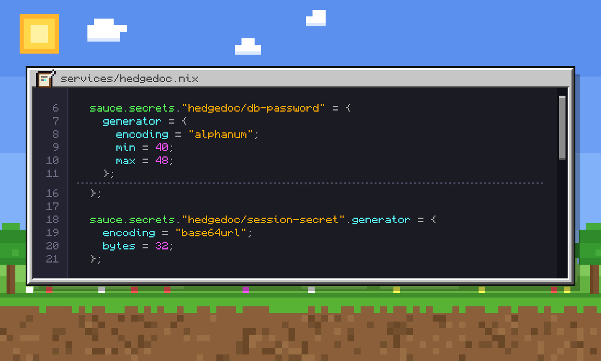

Alternative to [sops] & [sops-nix] with support for programmatic generation, length-obfuscation through padding, selective rotation, lifecycle tracking, a nicer editing experience, and [NixOS] integration with the local homelab-er and fleet-control in mind.

`secret-sauce` is built on the shoulders of giants ([sops], [sops-nix], [age], [ssh-to-age], [pgp], and many more). Familiarity with any of the aforementioned makes this easy.

## Quickstart

You can install the sauce cli from flake input or using:

```sh
nix shell github:v3xlabs/secret-sauce
```

Or by flake

```sh
inputs.sauce.url = "github:v3xlabs/secret-sauce";
```

A lot of the `sauce` nix configuration syntax follows or is similar to the [sops-nix] counterpart.

### Declare a secret

Secrets can be declared wherever you like, allowing you to organize your dotfiles in whatever way makes sense for you.

The `generator` field can be defined, for variables that can be rotated, think passwords, api-keys, most things:

```nix
sauce.secrets."kanidm/oauth2/freshrss" {
  generator = {
    encoding = "alphanum";
    min = 40;
    max = 48;
  };
};
```

The `once` field is similar to `generator` however only applied if no value exists; `once` is intended for use for disk-encryption, salts, etc.
Any values which if rotated would result in data-loss.

```nix
sauce.secrets."litellm/salt-key" = {
  once = {
    encoding = "alphanum";
    min = 40;
    max = 48;
  };
};
```

If no `generator` or `once` is defined a variable should be manually set.
For example upstream tokens you do not have control over: GH PATs, CF Tokens, etc.

```nix
sauce.secrets."github/pat" = { };
```

### Define the recipient

For each host you will want to define a small `sauce` block like so:

```nix
{
  sauce = {
    adminRecipients.age = [ "age1..." ];
    recipient.age = "age1...";
    identityFile = "/var/lib/sauce/host.key";
    defaultDir = ./secrets;
  };
};
```

## Commands

This is just a short list; for more refer to the manual or `sauce --help`

- `sauce list` - an overview of everything
- `sauce generate` - generates any empty secrets
- `sauce status` - shows a status overview
- `sauce set` - stores a secret, or its metadata
- `sauce get` - retrieves a secret
- `sauce edit` - opens in your `$EDITOR`
- `sauce rotate` - rotates a secret or glob of secrets
- `sauce search` - fzf-like search for use in scripts

## Why?

Well obviously because we needed **S**ome **A**lternative **U**naudited **C**rypto **E**ngine.

## Independent decryption

Open a file with an age X25519 identity: `python tools/sauce-decrypt.py secret.sauce.yaml identity.key --name secret/name`.
It prints the facts and the value length, or the value with `--print`.
It has no GPG support, so it cannot open the wrap of a GPG reader.
The development shell provides Python with `cryptography` and `bech32`.

[sops]: https://github.com/getsops/sops
[sops-nix]: https://github.com/Mic92/sops-nix
[age]: https://github.com/FiloSottile/age
[ssh-to-age]: https://github.com/Mic92/ssh-to-age
[pgp]: https://en.wikipedia.org/wiki/Pretty_Good_Privacy
[nixos]: https://nixos.org/
